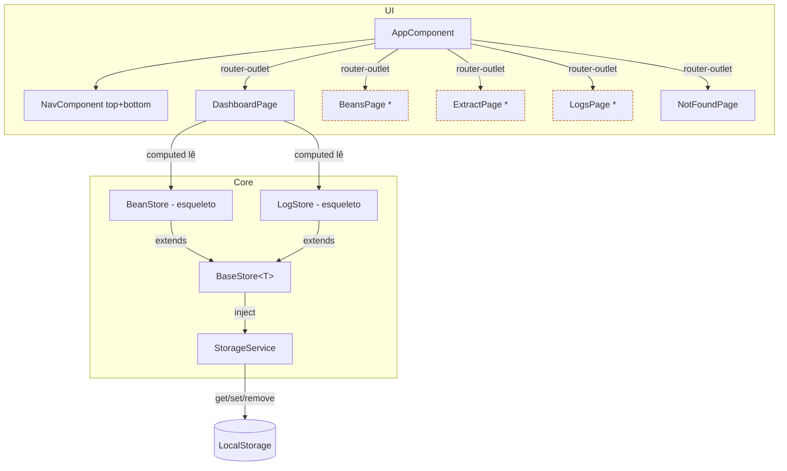

# App Shell + Infra — Design

**Spec**: `.specs/features/app-shell/spec.md`
**Context**: `.specs/features/app-shell/context.md`
**Status**: Approved (2026-08-05 — decisão "abertos" adiada para M2 confirmada pelo usuário)

---

## Resumo executivo

A M1 é a fundação: define o tooling concreto (todo pendente no STATE.md), o padrão de armazenamento versionado, o padrão de store Signals e o shell de navegação responsivo. Toda decisão aqui é herdada por M2–M4 — por isso este documento existe. Quando M2/M3/M4 executarem, substituem os placeholders de páginas e completam os stores esqueleto, **sem mudar contratos** (StorageService, BaseStore, rotas, tokens CSS).

Stack concreta decidida (resolver o todo do STATE.md):

| Item | Escolha | Fonte |
|---|---|---|
| CLI / build | `ng new` + builder `application` (esbuild) | Angular 21 default |
| Test runner | **Vitest** (`@angular/build:unit-test`) | Angular 21 tornou Vitest o default (Karma deprecado) |
| Zoneless | `provideZonelessChangeDetection()` (gerado pelo CLI) | Angular 21 default; alinha AD-002 (sem NgZone) |
| Lint | `ng add @angular-eslint/schematics` v21 (`eslint.config.ts` via `defineConfig`) | angular-eslint v21 suporta Angular 21 |
| Estilo | SCSS, arquivos gerados pelo CLI (style guide 2025 default) | CLI default |
| SSR/PWA | Não (app local, LocalStorage) | Out of scope (spec) |

---

## Architecture Overview

Fluxo de dados é sempre: **Componente → Store (signals) → StorageService → LocalStorage**. Stores nunca tocam LocalStorage diretamente (SHELL-14). Componentes consomem `computed()`/`signal()`; mutação e persistência vivem nos stores.



`*` = placeholder que M2/M3/M4 substituem. `BeanStore`/`LogStore` são esqueletos que M2/M4 completam.

---

## Code Reuse Analysis

Projeto greenfield — não há `.specs/codebase/` nem código existente. Reuso vem de:

| Recurso | De onde | Como usamos |
|---|---|---|
| Angular Router (standalone) | @angular/router | Rotas com `loadComponent` lazy + wildcard 404 |
| Control flow `@if`/`@for` | @angular/core | Templates do dashboard, nav, empty states |
| `signal`/`computed`/`effect` | @angular/core | Todo o estado (AD-002) |
| Vitest + Angular unit-test builder | @angular/build | Unit tests de services/stores |
| Tokens do DESIGN.md | `DESIGN.md` (AD-006) | Mapeados para CSS custom properties em `styles.scss` |
| Font stack monospace | DESIGN.md | `'Berkeley Mono', 'JetBrains Mono', ui-monospace, ...` |

### Integration Points

| Sistema | Método de integração |
|---|---|
| LocalStorage | Somente via `StorageService` (isolamento p/ migração futura AD-001) |
| Dashboard ↔ Stores | Stores expõem signals; dashboard deriva agregados com `computed()` |
| M4 ↔ M3 (futuro) | Estado do painel exposto via `computed()` (AD-005) — fora do escopo M1 |

---

## Components

### AppComponent (raiz)

- **Propósito**: shell da aplicação — renderiza header (wordmark ASCII) + navegação + `<router-outlet>`.
- **Localização**: `src/app/app.ts` (naming style 2025 do CLI)
- **Interfaces**: `routeAnimations` — nenhuma; estático.
- **Dependências**: `RouterOutlet` (import), `NavComponent`, `provideRouter` via `app.config.ts`.
- **Reusa**: tokens do DESIGN.md via classes globais.

### NavComponent (top + bottom)

- **Propósito**: navegação das 3 seções + Home. Renderiza **duas** barras — top nav (desktop) e bottom nav (mobile) — que alternam **somente via media query CSS** (≤480px mostra bottom nav, ≥768px mostra top nav). Sem detecção de breakpoint em JS.
- **Localização**: `src/app/shared/nav/nav.component.ts`
- **Interfaces**:
  - `links = [{ label: 'Home', path: '/', marker: '[⌂]' }, { label: 'Grãos', path: '/beans', marker: '[+]' }, { label: 'Extrair', path: '/extract', marker: '[~]' }, { label: 'Histórico', path: '/logs', marker: '[=]' }]`
- **Dependências**: `RouterLink`, `RouterLinkActive` (item ativo em espresso + marker ASCII — `button-tab`/`bottom-nav` do DESIGN).
- **Reusa**: tokens de navegação do DESIGN.md.

### DashboardPage

- **Propósito**: Home na rota `''` — resumo (SHELL-19): contagem de grãos, últimas extrações, atalhos para as 3 seções. Sem dados → empty states (D2).
- **Localização**: `src/app/features/dashboard/dashboard.page.ts`
- **Interfaces**:
  - `totalBeans = computed(() => beanStore.items().length)` — número em `display-md`
  - `recentLogs = computed(() => logStore.items())` — últimas extrações (vazio na M1)
  - `shortcuts = links das 3 seções`
- **Dependências**: `BeanStore`, `LogStore`, `RouterLink`.
- **Reusa**: tokens `dashboard-card`, `empty-state`, `link-inline`.

### BeansPage / ExtractPage / LogsPage (placeholders)

- **Propósito**: rotas `/beans`, `/extract`, `/logs` em M1 renderizando o título da seção (SHELL-16). M2/M3/M4 substituem o conteúdo.
- **Localização**: `src/app/features/beans/`, `extract/`, `logs/` — lazy-loaded via `loadComponent`.
- **Interfaces**: nenhuma além do template.
- **Dependências**: `heading-md` token.

### NotFoundPage

- **Propósito**: rota `**` — 404 amigável com link de volta à Home (SHELL-17).
- **Localização**: `src/app/features/not-found/not-found.page.ts`
- **Dependências**: `RouterLink` para `''`.

---

## Services

### StorageService

- **Propósito**: encapsula LocalStorage com acesso genérico tipado e schema versionado (D3). Única porta de entrada para persistência.
- **Localização**: `src/app/core/storage/storage.service.ts`, `providedIn: 'root'`.
- **Interfaces**:
  - `get<T>(key: string): T | null` — lê JSON; `null` se ausente, JSON inválido, **ou versão incompatível** (SHELL-06/08/10).
  - `set<T>(key: string, value: T): void` — serializa e grava `{ version, data }` (SHELL-05/07).
  - `remove(key: string): void` — apaga a chave (SHELL-09).
  - `SCHEMA_VERSION = 1` — constante estática da versão corrente do schema da app.
- **Dependências**: nada (injeta `window.localStorage` com `try/catch`).
- **Reusa**: nada.

**Como a versão funciona (decisão de design):** o StorageService armazena sempre um envelope `StoredEnvelope<T> { version: number; data: T }`. Ao ler, valida `version === SCHEMA_VERSION`; se difere, retorna `null` sem migrar (dados de schema antigo ficam indisponíveis até haver migração — AD-001). Isso mantém o serviço **genérico** (sem conhecer domínio) e satisfaz AC-3 ("payload armazenado contém campo `version`"). Os modelos de domínio ficam limpos (sem campo `version` — o envelope cuida disso).

**Storage indisponível (SHELL-15/edge):** toda operação em `try/catch`; `get` retorna `null`, `set`/`remove` viram no-op. Um único `console.warn` na primeira falha. App nunca lança na inicialização.

### BaseStore<T> (padrão de store)

- **Propósito**: define o padrão de store com Signals (AD-002, SHELL-11..14) — `signal()`/`computed()`, delegação ao StorageService.
- **Localização**: `src/app/core/stores/base-store.ts`
- **Interfaces** (abstratas):
  - `readonly storageKey: string` — chave no LocalStorage
  - `readonly items = signal<T[]>([])` — a coleção
  - `protected load(): void` — `storage.get<T[]>(key)` → `items.set`; `null` vira `[]`
  - `protected persist(): void` — `storage.set(key, items())`
  - `add(item: T): void` / `update(id, patch)` / `remove(id): void` — mutam + `persist()` **explícito**
- **Dependências**: `StorageService` (via `inject()` no construtor).
- **Reusa**: nada.

**Decisão de design:** persistência é **explícita** (chamar `persist()` após mutação), não via `effect()`. Efeitos reativos são reservados para side effects que precisam reagir a mudanças assíncronas (ex: timer da M3). Persistir explicitamente evita gravações redundantes e é deterministicamente testável.

### BeanStore / LogStore (esqueletos)

- **Propósito**: stores de exemplo/primeiro uso do padrão, já consumíveis pelo dashboard (SHELL-13). **Esqueletos que M2 (Bean) e M4 (Log) completam** — a M1 cria apenas o modelo mínimo necessário ao dashboard.
- **Localização**: `src/app/core/stores/bean.store.ts`, `log.store.ts`, `providedIn: 'root'`.
- **Interfaces** (M1):
  - `BeanStore.items`, `BeanStore.add/remove/update` (base)
  - `LogStore.items`, idem
- **Dependências**: `BaseStore`, `StorageService`.
- **Reusa**: padrão `BaseStore`.

---

## Data Models

### StoredEnvelope<T> (interno do StorageService)

```typescript
interface StoredEnvelope<T> {
  version: number   // === StorageService.SCHEMA_VERSION
  data: T
}
```

**Relacionamentos**: invólucro de tudo que é persistido. Modelos de domínio **não** carregam `version`.

### Bean (esqueleto M1 — M2 expande)

```typescript
interface Bean {
  id: string
  brand: string       // única obrigatória na M2 (AD-004)
  createdAt: string   // ISO — ordenação dos cards (newest-first)
}
```

**Relacionamentos**: `BeanStore.items: Bean[]`. **Nota de design**: a contagem de "grãos **abertos**" (SHELL-19) precisa do campo `status`, que é domínio da M2 (AD-004). Na M1 o dashboard exibe **total de grãos** + empty state ("dados zerados/vazios na M1"); o filtro por status chega junto com o modelo completo na M2. ⚠️ *requer confirmação do usuário.*

### BrewLog (esqueleto M1 — M4 expande)

```typescript
interface BrewLog {
  id: string
  method: string      // placeholder: método da extração
  createdAt: string   // ISO — ordenação (newest-first)
}
```

**Relacionamentos**: `LogStore.items: BrewLog[]`. M4 define o modelo sensorial completo (AD-007).

---

## Error Handling Strategy

| Cenário | Tratamento | Impacto no usuário |
|---|---|---|
| LocalStorage bloqueado pelo browser | `try/catch` em toda operação; `get`→`null`, `set`/`remove`→no-op; `console.warn` 1x | App inicia normal; dados não persistem (estado vazio) |
| JSON corrompido em uma chave | `JSON.parse` em `try/catch` → `null` só para aquela chave | Demais chaves continuam funcionando |
| Versão de schema incompatível | `version !== SCHEMA_VERSION` → `null` (sem migração na v1) | Dados antigos invisíveis; sem crash |
| Deep link em rota inválida | Rota `**` → `NotFoundPage` | Tela 404 amigável com link Home |
| Dashboard sem dados | Empty states (`empty-state` token) por card | "Nenhum grão registrado" etc., sem erro |
| JSON.parse de dados ausentes | Retorna `null` | Estado vazio |

---

## Tech Decisions (não óbvias)

| Decisão | Escolha | Rationale |
|---|---|---|
| Tooling | Angular CLI 21 + Vitest + angular-eslint 21 | Defaults oficiais do Angular 21; Karma deprecado; zero inventar |
| Zoneless | Default do `ng new` v21 | AD-002 (sem NgZone); testes já rodam zoneless |
| Versionamento de schema | Envelope `{ version, data }` + `SCHEMA_VERSION` constante no StorageService | Mantém serviço genérico; AC-3/AC-4 satisfeitos sem acoplar domínio |
| Persistência | `persist()` explícito após mutação (não via `effect()`) | Determinístico, testável; `effect()` reservado p/ side effects reativos (M3) |
| Breakpoints de nav | CSS media queries (≤480px bottom, ≥768px top); ambos no DOM | Sem JS de breakpoint; alinha DESIGN.md e simplifica teste manual |
| Lazy loading | `loadComponent` nas 3 rotas de feature | Código por feature só carrega quando navegada |
| Fontes | Google Fonts (JetBrains Mono) + stack system fallback | Berkeley Mono é pago; fallback open-source do DESIGN.md |
| Dashboard M1 | Total de grãos + empty states | Filtro "abertos" depende do modelo M2 (ver nota acima) |

---

## Testes & Gate

**Unit tests (Vitest):**
- `StorageService` (`storage.spec.ts`): set→get roundtrip; key ausente→`null`; versão incompatível→`null`; JSON corrompido→`null`; `remove`; storage indisponível→`null`/no-op sem throw. (SHELL-05..10)
- `BeanStore`/`LogStore` (`*.spec.ts`): `items` inicia vazio; `add`/`remove`/`update` mutam signal e delegam ao StorageService (mock). (SHELL-11..14)

**Verificação manual (navegador):**
- Rotas `''`, `/beans`, `/extract`, `/logs` e 404 (SHELL-15..17)
- Viewport ≤480px → bottom nav fixa; ≥768px → top nav (SHELL-18)
- Dashboard vazio exibe empty states + contagem 0 (SHELL-19)
- Console limpo no load (SHELL-04)

**Gate:** `ng test` verde · `ng build` sem erros · `ng lint` limpo · navegação manual nas 4 telas + 404 em mobile e desktop.

---

## Fora do escopo desta fase (design)

- Modelo completo de Bean (M2), estado do painel/timer (M3), modelo sensorial do log (M4).
- Migração de schema (v1 = retornar `null`; AD-001).
- Persistir preferências de UI (nenhuma na v1).
