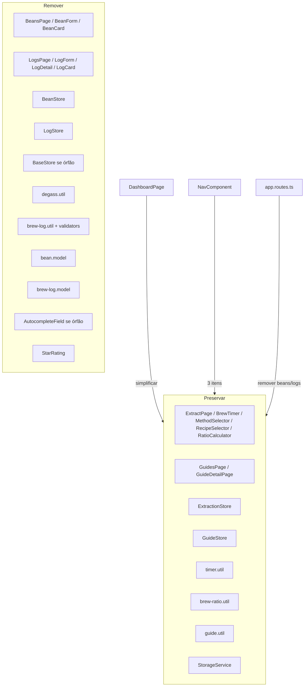

# App Simplificado — Design

**Spec**: `.specs/features/app-simplification/spec.md`
**Context**: `.specs/features/app-simplification/context.md`
**Status**: Approved (2026-09-08)

## Resumo executivo

M7 corta 2 domínios (Grãos e Logs) e preserva Extração + Guias. É um **refactor de deleção**: remover rotas, stores, utils, models, components, specs e referências no dashboard/nav/extraction-store sem quebrar o fluxo guiado (`/guides` → `/extract` com `scaledPhases(totalWater)` e timer por receita). Nenhuma lógica nova de domínio — só limpeza + ajustes de wiring.

## Architecture Overview

## Mudanças por arquivo

| Arquivo | Ação |
|---|---|
| `src/app/app.routes.ts` | Remover rotas `beans`, `beans/new`, `beans/:id/edit`, `logs`, `logs/new`, `logs/:id`, `logs/:id/edit` |
| `src/app/shared/nav/nav.component.ts` | Nav com 3 itens: Home, Extrair (`/extract`), Guias (`/guides`). Atualiza `NAV_ITEMS` e testes |
| `src/app/features/dashboard/dashboard.page.ts` | Remove `BeanStore`/`LogStore` injects, contadores, `recentLogs`, listas. Mostra atalhos Extrair/Guias + receita preferida opcional via `GuideStore` |
| `src/app/features/extract/extract.page.ts` | Remover botão/atalho "Salvar no histórico" e import de `brewState` para logs |
| `src/app/core/stores/extraction.store.ts` | Remover ponte para logs se houver; manter `BrewState` apenas para timer (não é usado por logs após corte) — pode simplificar mas não obrigatório |
| Deletar | `bean.model.ts`, `brew-log.model.ts`, `bean.store.ts`, `log.store.ts`, `base-store.ts` (se sem uso), `degass.util.ts`, `brew-log.util.ts`, `validators.util.ts` (se só usado por logs/beans), `bean-card`, `beans.page`, `bean-form`, `log-card`, `logs.page`, `log-form`, `log-detail`, `star-rating`, `autocomplete-field` (se órfão), specs correspondentes |
| `src/app/app.spec.ts` | Atualizar expectativas de nav |
| `DESIGN.md` / docs | Opcional: atualizar se referencia Grãos/Logs |

**Decisão**: `BaseStore` é usado só por `BeanStore`/`LogStore` — após remoção fica órfão e pode ser deletado. `AutocompleteField` era usado por bean-form e log-form — ambos removidos → deletar. `StarRating` só em logs → deletar. `validators.util` verificar uso — se só em bean/log forms, deletar.

## Testes & Gate

- `npm test` — remover specs deletados; ajustar `app.spec` e `dashboard` specs; suite esperada ~110-120 tests
- `npm run build` e `ng lint` verdes
- Manual: nav 3 itens desktop/mobile, `/beans` e `/logs` → 404, dashboard sem grãos/logs, fluxo receita→timer intacto

## Fora de escopo

- Novas receitas/métodos, edição de receitas, migração de dados antigos
